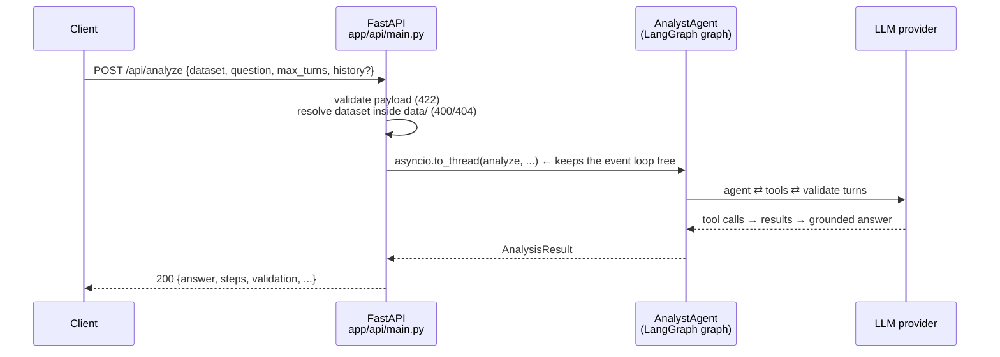
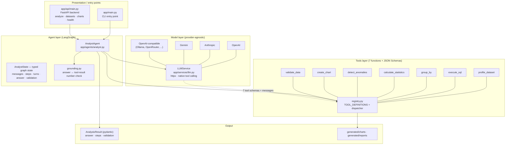
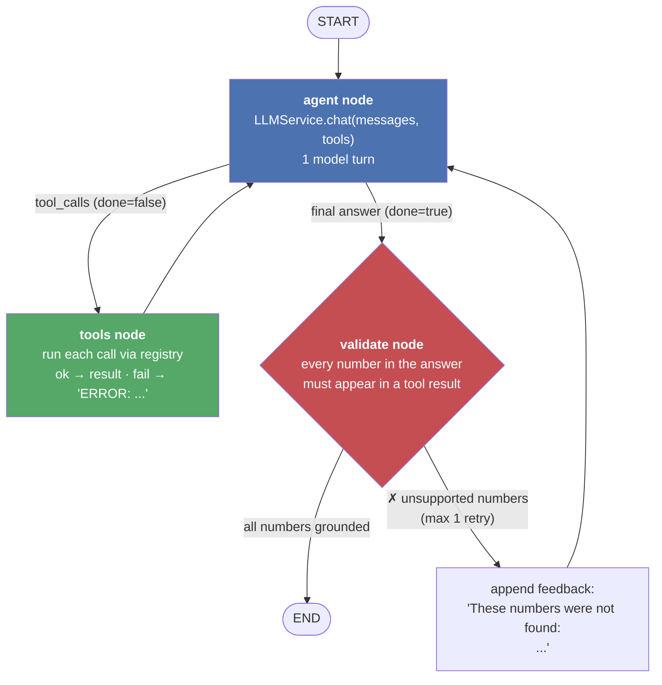
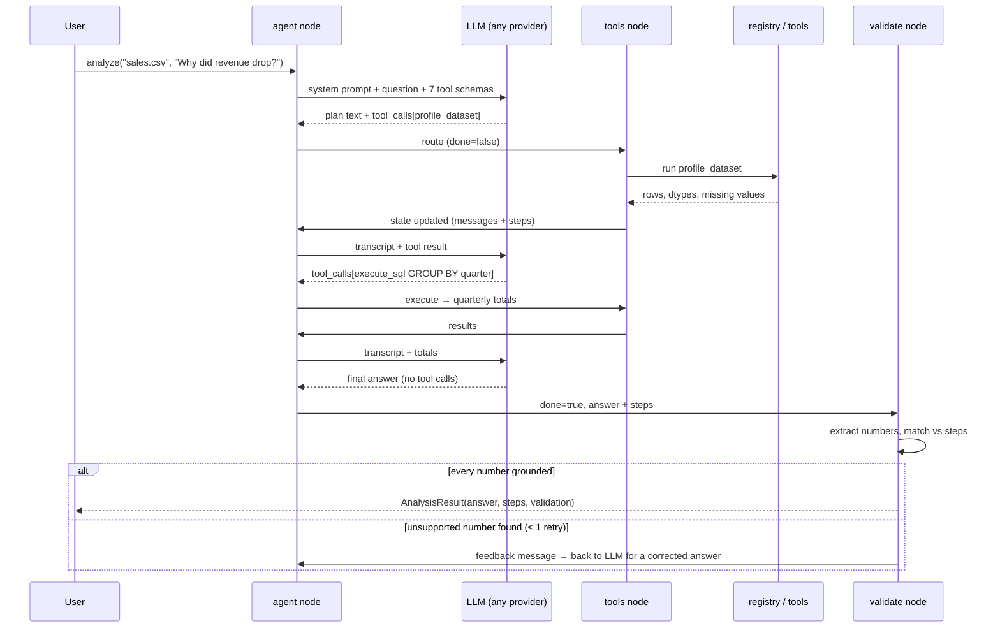

# AI Data Analyst

An autonomous data analyst agent: ask a question about a CSV in natural
language, and a **LangGraph** agent plans, calls tools (SQL, pandas, statistics,
charts, validation), and answers — with every number in the final answer
**automatically validated** against real tool output. Exposed as a CLI and a
**FastAPI** backend.

- **7 tools** — profiling, SQL, grouping, statistics, anomalies, charts, data validation
- **LangGraph `StateGraph`** — plan → tools → observe → answer → ground-check
- **Any LLM provider** — OpenAI, Anthropic, Gemini, or any OpenAI-compatible endpoint (raw HTTP, no vendor SDK)
- **FastAPI backend** — analyze, datasets, charts, health/tools endpoints

---

## Setup

```powershell
cd ai-data-analyst
py -m venv .venv
.venv\Scripts\Activate.ps1
pip install -r requirements.txt
```

Configure any provider in `.env`:

```
LLM_PROVIDER=openai            # openai | openai_compatible | anthropic | google
LLM_API_KEY=sk-...
LLM_MODEL=gpt-4o-mini
# LLM_BASE_URL=http://localhost:11434/v1   # for openai_compatible endpoints
```

Or in code:

```python
from app.services.llm import LLMService

llm = LLMService(api_key="sk-...", model_name="claude-sonnet-4-5", provider="anthropic")
llm.complete("Summarize this dataset")
```

## Usage

**CLI:**

```powershell
python -m app.main
```

**API server:**

```powershell
uvicorn app.api.main:app --reload      # or: python -m app.api
# interactive docs → http://127.0.0.1:8000/docs
```

**Web UI (frontend/):**

```powershell
# terminal 1 — backend
uvicorn app.api.main:app --port 8000

# terminal 2 — frontend (proxies /api → :8000)
cd frontend
npm install
npm run dev                            # → http://localhost:5173
```

The UI streams the agent loop live: graph nodes pulse as they run, tool calls
appear as timeline cards, and the grounding verdict lands before the answer.
See [`frontend/README.md`](frontend/README.md) for details.

```python
from app.agents.analyst import AnalystAgent

agent = AnalystAgent()
result = agent.analyze("data/sales.csv", "Why did revenue decrease in Q3?")

print(result.answer)          # final answer, every number grounded
print(result.validation)      # {"passed": True, "checked": 5, "unsupported": [], ...}
for step in result.steps:     # full audit log of tool calls
    print(step["tool"], step["arguments"], step["status"])

print(agent.graph.get_graph().draw_mermaid())   # render the graph
```

---

## API (FastAPI)

```powershell
uvicorn app.api.main:app --reload      # or: python -m app.api
# Swagger UI → http://127.0.0.1:8000/docs   ·   ReDoc → /redoc
```

### Endpoints

| Method | Path | Purpose |
|---|---|---|
| `GET` | `/` | service info + endpoint list |
| `GET` | `/api/health` | status, provider, model, `llm_available` (never the key) |
| `GET` | `/api/tools` | the 7 tool schemas (same ones sent to the LLM) |
| `GET` | `/api/datasets` | CSVs available in `data/` (name + size) |
| `POST` | `/api/datasets` | upload a CSV (multipart, `.csv` only) → `{name, size}` |
| `POST` | `/api/analyze` | run the agent → `AnalysisResult` (answer, steps, validation) |
| `POST` | `/api/analyze/stream` | same run, streamed as **NDJSON events** (`node`, `plan`, `step`, `validation`, `retry`, `done`) — used by the frontend |
| `GET` | `/api/charts` | list generated chart PNGs |
| `GET` | `/api/charts/{name}` | serve a chart image |

### Request flow



**Design notes**

- `create_app(agent=...)` — app factory with agent injection, so tests run the
  full API offline with a scripted fake LLM
- blocking work (LLM + pandas) runs via `asyncio.to_thread` — the server stays responsive
- dataset/chart names are validated (`bare file name + suffix` only) → path
  traversal (`../`) returns 400, unknown files 404
- upload accepts only non-empty `.csv` files and strips client paths
- CORS open for local frontends; the API key is never exposed (only `llm_available`)

### Examples

```powershell
# ask a question
curl -X POST http://127.0.0.1:8000/api/analyze `
  -H "Content-Type: application/json" `
  -d '{"dataset":"sales.csv","question":"Which region had the highest revenue?","max_turns":8}'

# follow-up — replay earlier turns so the agent has context
curl -X POST http://127.0.0.1:8000/api/analyze `
  -H "Content-Type: application/json" `
  -d '{"dataset":"sales.csv","question":"And by product?","history":[{"question":"Which region had the highest revenue?","answer":"North (5737.20)","tool_results":["revenue 5737.20"]}]}'

# upload a dataset
curl -X POST http://127.0.0.1:8000/api/datasets -F "file=@my_data.csv"

# health + tools
curl http://127.0.0.1:8000/api/health
curl http://127.0.0.1:8000/api/tools
```

Response of `POST /api/analyze`:

```json
{
  "dataset": "sales.csv",
  "question": "Which region had the highest revenue?",
  "answer": "North had the highest revenue at 4,662.25 ...",
  "steps": [
    {"tool": "profile_dataset", "arguments": {}, "status": "ok", "result": "..."},
    {"tool": "execute_sql", "arguments": {"sql": "SELECT region, SUM(revenue) ..."}, "status": "ok", "result": "..."}
  ],
  "validation": {"passed": true, "checked": 3, "unsupported": [], "tool_results": 2}
}
```

---

## Architecture

### Layer overview



**How the layers talk to each other:**

| Layer | Responsibility | Key rule |
|---|---|---|
| `main.py` | entry point | thin — no logic |
| Agent (LangGraph) | orchestration: when to call the model, tools, validation | never computes numbers itself |
| Tools | deterministic data work | pure functions: `(dataset, args) -> str/dict` |
| Model | planning + language | only sees schemas + tool results, never raw files |
| Schemas | typed results | everything the caller needs in one object |

### The agent graph

The heart of the system — a ReAct-style cycle with a grounding gate on exit:



**Nodes and edges explained:**

| Element | What it does |
|---|---|
| **state** (`AnalystState`) | typed dict shared by all nodes: `messages` (chat transcript), `steps` (audit log), `turns` (model calls), `answer`, `done`, `validation`, `validation_retries` |
| **`agent` node** | one model turn. If the model returns tool calls → append them to state. If it returns plain text → that's the final answer (`done=true`). If `max_turns` is exhausted → one **forced tool-free call** that summarises the evidence already gathered (placeholder only if even that fails) |
| **`tools` node** | executes every pending tool call via `registry.run_tool`, appends results to `messages` and `steps`. Exceptions become `ERROR: ...` strings fed back so the model can self-correct |
| **`validate` node** | deterministic grounding check (`grounding.py`): extracts every number from the answer and requires it to trace back to a tool result (or the user's own question). Matching tolerates **display rounding** — a tool result of `0.2748` grounds an answer of `0.275` — and folds Unicode punctuation models emit (narrow-space thousands separators, U+2212 minus). Pass → `END`; fail → inject a feedback user message and retry **at most once** |
| **conditional edges** | `agent → tools` while `done=false`; `agent → validate` on a final answer; `validate → END` or `validate → agent` |

### One run, step by step



### Tool-calling across providers

`LLMService` speaks one neutral format — `{name, description, parameters}`
schemas and plain-dict messages — and translates per provider:

| Provider | Request | Response parsing |
|---|---|---|
| `openai` / `openai_compatible` | `tools: [{type:"function"...}]`, `tool_choice:"auto"` | `message.tool_calls[]` (JSON-string args) |
| `anthropic` | `tools[].input_schema`, separate `system` | `content[]` blocks: `tool_use` / `text` |
| `google` | `tools[].functionDeclarations`, `systemInstruction` | `parts[].functionCall` (args already objects) |

All three collapse into one `ChatResponse(text, tool_calls[ToolCall(id, name, arguments)])`,
and history is rebuilt in the right wire format each turn (Anthropic tool
results become `tool_result` blocks, Gemini's become `functionResponse`, ...).

### Failure resilience

- **Transient LLM failures are retried** (429 / 5xx / timeouts) with a small
  backoff (`LLMService.chat`, `config.max_retries = 2`), so a momentary
  provider hiccup does not kill a run. 4xx auth errors are never retried.
  Provider errors surface as short single-line messages, never raw JSON dumps.
- **A run can never end without an answer.** If the model is unreachable
  mid-run (outage, exhausted free-tier quota), the agent converts the tool
  results gathered so far into a deterministic **evidence digest** and ships
  it as the final answer (marked "Analysis interrupted" with the reason),
  instead of failing the stream with an `error` event. The digest is shown
  as-is — it is not grounding-scored, because re-entering the loop would
  just fail again on the same outage.

### Two layers of validation

| Layer | Where | What it checks |
|---|---|---|
| **`validate_data` tool** | invoked *by the model* during analysis | data quality: nulls, ranges, allowed values, uniqueness, numeric types, cross-column expressions, duplicates — returns pass/fail per rule with offending rows; failed rules become caveats in the answer |
| **`validate` node** | runs *on* the model's final answer | grounding: every number in the answer must trace back to a tool result (or the user's question), allowing normal display rounding and percent/decimal forms (`5%` ↔ `0.05`); unsupported numbers trigger one corrective retry, then the verdict ships in `result.validation` |

The tool lets the agent inspect data; the node is a **hard guarantee the model
cannot skip** — it runs on the graph path to `END`.

---

## Project structure

```
ai-data-analyst/
├── app/
│   ├── main.py                  # CLI entry point: run one analysis
│   │
│   ├── api/
│   │   ├── main.py              # FastAPI app factory: /api/analyze, /api/datasets,
│   │   │                        #   /api/charts, /api/health, /api/tools + CORS
│   │   └── __main__.py          # `python -m app.api` → uvicorn on :8000
│   │
│   ├── agents/
│   │   ├── analyst.py           # LangGraph StateGraph: agent / tools / validate nodes,
│   │   │                        #   system prompt, AnalystState, AnalystAgent.analyze()
│   │   └── grounding.py         # answer validation: numbers must exist in tool results
│   │
│   ├── tools/
│   │   ├── registry.py          # 7 tool JSON Schemas + run_tool() dispatcher
│   │   ├── profiler.py          # profile_dataset — shape, dtypes, nulls, samples
│   │   ├── pandas_tool.py       # execute_sql helper + group_by
│   │   ├── sql_tool.py          # execute_sql — DuckDB (SQLite fallback), {table}
│   │   ├── statistics.py        # calculate_statistics, detect_anomalies (IQR/z-score)
│   │   ├── validation.py        # validate_data — rule engine (7 check types)
│   │   └── visualization.py     # create_chart — bar/line/histogram/scatter → PNG
│   │
│   ├── services/
│   │   └── llm.py               # provider-agnostic LLM client: LLMConfig, ChatResponse,
│   │                            #   ToolCall, native tool calling over httpx
│   │
│   └── schemas/
│       ├── analysis.py          # AnalysisResult (pydantic): answer, steps, validation
│       └── api.py               # AnalyzeRequest, HealthInfo, DatasetInfo, ...
│
├── data/
│   └── sales.csv                # sample dataset (20 rows)
│
├── generated/
│   ├── charts/                  # PNGs written by create_chart
│   └── reports/                 # future: written reports
│
├── tests/                       # 62 tests — no API key required
│   ├── test_agent.py            # loop behavior via scripted fake LLM
│   ├── test_langgraph_agent.py  # graph topology, state schema, validation retries
│   ├── test_llm_service.py      # config + request/response basics
│   ├── test_llm_tools.py        # tool wire format for all 4 provider modes
│   ├── test_registry.py         # every tool executes correctly on sales.csv
│   ├── test_validation.py       # validate_data rules + grounding checks
│   └── test_api.py              # FastAPI endpoints + NDJSON stream via fake agent
│
├── frontend/                    # React 19 + Vite 6 + Tailwind v4 + shadcn-style UI
│   ├── src/
│   │   ├── App.tsx              # stage machine: intake → running → result
│   │   ├── api/client.ts        # fetch helpers + NDJSON stream reader
│   │   ├── components/
│   │   │   ├── ui/              # shadcn-style primitives (button, card, badge, ...)
│   │   │   ├── IntakeScreen.tsx # stage 1: chat composer + dataset upload
│   │   │   ├── RunningScreen.tsx# stage 2: animated live agent trace
│   │   │   ├── ResultScreen.tsx # stage 3: answer + charts + follow-up composer
│   │   │   ├── TraceGraph.tsx   # live agent ⇄ tools ⇄ validate visualiser
│   │   │   ├── StepCard.tsx     # timeline card per tool call
│   │   │   ├── ValidationBadge.tsx  # grounding verdict shield
│   │   │   └── Header/Markdown
│   │   └── index.css            # shadcn theme tokens (slate + blue accent)
│   └── README.md                # UI architecture + streaming protocol
│
├── .env                         # LLM_PROVIDER / LLM_API_KEY / LLM_MODEL / LLM_BASE_URL
├── .gitignore                   # venv, caches, secrets, generated output, node_modules
├── requirements.txt             # pandas, scipy, duckdb, matplotlib, httpx, langgraph,
│                                #   fastapi, uvicorn, python-multipart, pytest
└── README.md
```

### The 7 tools

| Tool | Purpose | Key arguments |
|---|---|---|
| `profile_dataset` | shape, dtypes, missing values, duplicates, sample rows — *call first* | — |
| `execute_sql` | SQL over the dataset | `sql` (use `{table}` placeholder) |
| `group_by` | split/aggregate in pandas | `by[]`, `values[]`, `agg` ∈ sum/mean/count/min/max/median |
| `calculate_statistics` | descriptive stats + correlations | `columns[]` (optional) |
| `detect_anomalies` | outliers with bounds + offending rows | `column`, `method` ∈ iqr/zscore, `threshold` |
| `create_chart` | saves a PNG under `generated/charts/` | `chart_type` ∈ bar/line/histogram/scatter, `x`, `y`, `title` |
| `validate_data` | data-quality rules with pass/fail + samples | `rules[]` (omit → default nulls + duplicate checks) |

Check types for `validate_data`: `not_null`, `unique`, `numeric`, `range`,
`allowed`, `expression` (row-level pandas query), `no_duplicates`.

---

## Guarantees

- **No invented numbers** — deterministic grounding gate on every final answer
- **Follow-ups keep context** — `history: [{question, answer, tool_results}]` replays earlier turns to the model, and their tool results join the grounding corpus so reused numbers stay valid
- **No silent tool failures** — exceptions come back as `ERROR: ...` so the model retries with corrected arguments
- **No runaway loops** — `max_turns` on model calls, `MAX_ANSWER_RETRIES = 1` on validation, `recursion_limit` derived from both
- **Full audit trail** — `result.steps` records tool, arguments, status, and full result for every call

## Tests

```powershell
pytest          # 81 tests, offline (fake LLM + injected fake agent, no API key)
```

## Extending

**Add a tool** — 3 edits in `app/tools/registry.py`: the function, the
`TOOL_FUNCTIONS` entry, and the `TOOL_DEFINITIONS` schema; the prompt and every
provider wire format pick it up automatically.

**Add a graph node** — add it in `AnalystAgent._build_graph()` with
`graph.add_node(...)` and route to it via a conditional edge; node updates are
partial dicts merged into `AnalystState`.

**Add an API endpoint** — a new `@application.get/post(...)` handler inside
`create_app()` in `app/api/main.py` (request/response models go in
`app/schemas/api.py`); it appears in the auto-generated `/docs` immediately.
